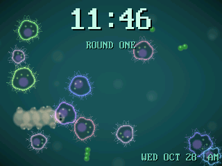
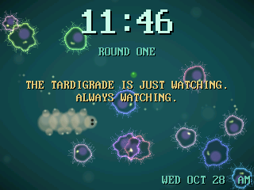
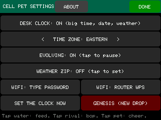
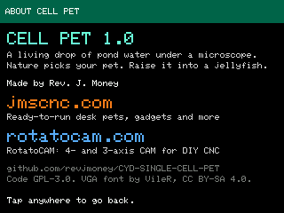
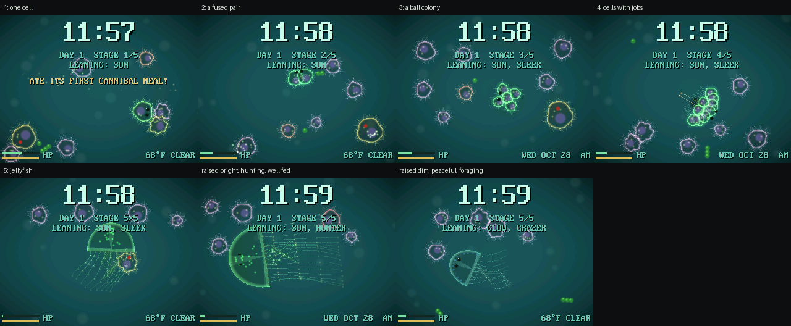

# Cell Pet

**A living drop of pond water on a $15 touchscreen.** Nature picks your pet from a drop of random cells. Over about a week it evolves from one cell into a jellyfish, and the way you raise it decides what kind of jellyfish you get. It doubles as a desk clock you can leave on all day.

Cell Pet is open-source firmware for the **ESP32-2432S028R**, the 2.8" "Cheap Yellow Display" (CYD). Everything is drawn live at the panel's full 320x240, at about 25 frames a second, with both of the ESP32's cores sharing the work. There are no sprites and no stored pictures. Membranes breathe, cilia beat, and tentacles trail and sway.



*Captured straight off the board: round one, a silly achievement, and a grown jellyfish.*

## What it does

- **Round one: nature picks.** A fresh drop holds 8 random cells, each born with its own leanings: light or dark, hunter or grazer, greedy or modest. They graze, bump and fight. The first one to prove itself gets a ring of sparks and **THIS ONE IS YOURS**. You can drop food to nudge nature along, but you can't pick.
- **A week of evolving, in five stages.** One cell, then a fused pair, a ball colony, a colony whose cells have jobs (a mouth, a ring of beating hairs, stinging threads), and finally a **jellyfish**: a pulsing glassy bell, frilly arms, and up to 16 trailing tentacles that catch food.
- **How you raise it shapes it.** The light sensor on the front counts the room's daytime light: a bright room grows green algae partners, a dim one makes it glow. Winning fights makes a hunter, with long stinging tentacles and amber colors. A peaceful life makes a see-through grazer. Lots of food from you makes it plump; foraging alone makes it sleek. Each stage locks in the care so far, so its history shows.
- **It never dies.** A neglected pet forages on its own, and a beaten one bursts away and recovers.
- **Silly achievements.** Every 3 to 45 minutes a line pops up from a pool of 150, written for each stage: *LEARNED TO TIE SHOES! (HAS NO SHOES.)* ... *ADOPTED AN ALGAE. NAMED IT GREG.* A few fire on real events, like *ATE ITS FIRST CANNIBAL MEAL!*
- **The RGB LED on the back blinks along.** Red when your pet eats another cell, green when it eats algae, and white for its big moments: crowned, cheered on, a new stage, an achievement.
- **Desk clock.** A big time with the date and local weather, set over WiFi at boot. The radio switches off again so the pond gets all the memory, and the clock resyncs every night at 4 AM.
- **Pause anytime.** EVOLVING: PAUSED holds it at its current stage for as long as you like. GENESIS starts a fresh drop (it asks first).

| An achievement | The settings | About |
|---|---|---|
|  |  |  |



## Get one

- **Ready to plug in:** a 2.8" CYD with Cell Pet already on it is at **[jmscnc.com](https://jmscnc.com)**. Plug it into any USB charger.
- **Flash your own:** any ESP32-2432S028R works, with an ILI9341 or ST7789 panel; the firmware detects which.

```
pio run -t upload
```

You need [PlatformIO](https://platformio.org/). The SD card slot is never touched, so whatever is on the card is safe.

## Using it

- **Tap the water** to drop algae.
- **Tap a rival** to bop it. This only works once you have a pet; round one is pure nature.
- **Tap your pet** to cheer it on.
- **Hold the screen still for 2 seconds** to open the settings:
  - **DESK CLOCK**
  - **TIME ZONE**
  - **EVOLVING** (pause or resume)
  - **WEATHER ZIP:** a US ZIP code, typed on the on-screen keyboard.
  - **WIFI:** type the password on the on-screen keyboard, or use your router's WPS button.
  - **SET THE CLOCK NOW**
  - **GENESIS (NEW DROP)**
  - **ABOUT**

## For tinkerers

Serial is at 921600 baud.

- **Everyday commands:**
  - `i` shows frame rate and memory.
  - `t` shows the pet's traits and care tallies.
  - `T x y` is a tap at x, y.
  - `M` opens the settings.
- **Screenshots:**
  - `S` sends a screenshot of the pond; `python tools/shot.py COM17 out.png` saves one.
  - `P0` and `P1` capture the settings and About screens.
- **Testing:**
  - `+` adds 6 hours of evolving, and `n` jumps to the next stage.
  - `w` speeds up round one, `h` holds it, and `r` starts a new drop.
  - `q` shows the next achievement.
  - `F sun hunt plump` forces how the body looks (not saved).
- **Filming:**
  - `Z` freezes the pond, and `.` steps it 50 ms.
  - `python tools/film.py COM17 outdir` uses that to capture frames that play back at true speed.

How it works:

- **Rendering:** `src/render.cpp` draws each 16-line strip straight from a snapshot of the pond, so no full frame ever sits in memory. Core 0 draws the even strips and sends every strip to the panel by DMA, while a helper on core 1 draws the odd ones.
- **The pond:** `src/world.cpp` simulates the drop on core 1.
- **Evolution rules:** these live in `lib/evolve/` as plain C++ with host tests (`powershell -File tools\test.ps1`, needs MSVC `cl`). That covers the stage clock, care tallies, the checksummed save, and the achievement picker.
- **Achievements:** the lines live in `docs/achievements.md`. `python tools/make_quips.py` turns them into code.
- **Saving:** the pet is saved to flash every minute and at every big moment, with a checksum, so a power cut never loses it.

## Credits

- Code by **Rev. J. Money**, licensed GPL-3.0-or-later (see `LICENSE`).
- The IBM VGA 8x16 font comes from [The Ultimate Oldschool PC Font Pack](https://int10h.org/oldschool-pc-fonts/) by VileR, under [CC BY-SA 4.0](https://creativecommons.org/licenses/by-sa/4.0/).
- The CYD panel and touch pin map comes from bdring's FluidDial CYD support.

---

More from the same workshop: **[RotatoCAM](https://rotatocam.com)**, 4- and 3-axis CAM for DIY CNC, at **[rotatocam.com](https://rotatocam.com)**.
